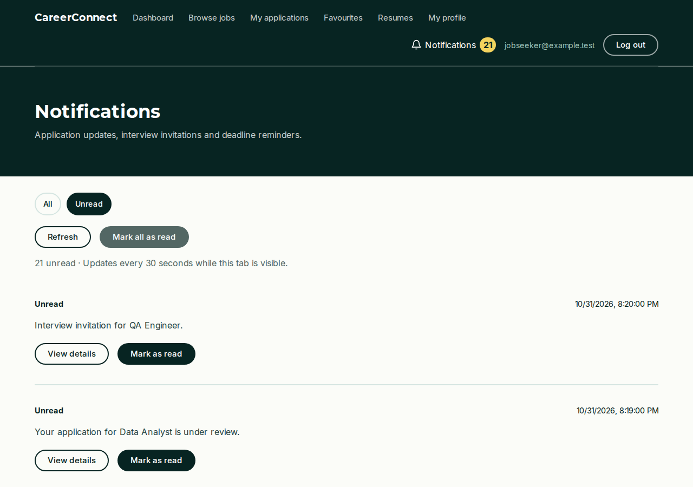

# Demo the unread inbox

The bell counts every unread alert. The All view shows up to the 200 newest notifications, so an older interview invitation can be missing from that view even while the bell counts it. Unread searches the signed-in user’s unread notifications first, then displays them in batches of 20. The selected view survives a reload and browser Back.

## Run the local demo

From the repository root, install dependencies with `npm ci` if needed, then run:

```sh
npm run build:test
npm run preview:recruiter -- --unread-demo
```

1. Open the local address printed by the preview. Log in as `jobseeker@example.test` with any password and select the bell. It shows **21** unread. In **All**, the newest message is “Reviewed update 201.”
2. Select **Unread**. The QA Engineer interview invitation appears first. Refresh the page to see the same filtered view.
3. Select **Load more** at the bottom. The 21st alert is an older Product Designer interview invitation. Mark it as read. It disappears from this view and the bell changes to **20**.
4. Select **Mark all as read**. The inbox shows **No unread notifications** and the bell’s badge clears. Select **View all notifications** to return to the read history.

The preview uses local synthetic accounts and resets the data when restarted. The [browser test](../../tests/browser/notification-filter.spec.mjs) exercises these steps using the same [sample notifications](../../tests/fixtures/unread-inbox.mjs).


